# Cahier des charges : Plateforme Cloud-Native sécurisée (DevSecOps sur Kubernetes)

| | |
|---|---|
| **Projet** | `devsecops-platform` |
| **Version** | 1.0 |
| **Auteur** | Achraf Ettanouti |
| **Type** | Projet personnel / portfolio (stage DevSecOps / Cloud) |
| **Durée** | 8 semaines (≈ 10 à 15 h / semaine) |
| **Statut** | En cours |

---

## 1. Contexte et problématique

Dans les organisations modernes, le délai entre l'écriture du code et sa mise en production se compte en heures. La sécurité, si elle est traitée à la fin, devient un goulot d'étranglement ou, pire, est contournée.

Ce projet démontre l'approche **"Shift-Left Security"** : intégrer la sécurité à **chaque étape** du cycle de vie (code, build, déploiement, exécution), de manière **automatisée, traçable et reproductible**.

**Problématique :**
> Comment livrer en continu une application conteneurisée sur Kubernetes tout en garantissant qu'aucun code vulnérable, secret exposé ou image non vérifiée n'atteint la production ?

---

## 2. Objectifs

### 2.1 Objectif général
Concevoir et déployer une plateforme cloud-native complète, sécurisée de bout en bout, observable et décrite en Infrastructure as Code.

### 2.2 Objectifs spécifiques (SMART)

| ID | Objectif | Indicateur de réussite |
|---|---|---|
| OBJ-1 | Automatiser le build/test/déploiement | Pipeline complet < 10 min, 0 étape manuelle |
| OBJ-2 | Détecter les failles avant la production | 5 contrôles de sécurité bloquants dans la CI |
| OBJ-3 | Garantir l'intégrité de la chaîne logistique logicielle | 100 % des images signées et accompagnées d'un SBOM |
| OBJ-4 | Appliquer le principe du moindre privilège | 0 conteneur root, NetworkPolicies en *default deny* |
| OBJ-5 | Déployer en GitOps | Git = unique source de vérité, dérive corrigée automatiquement |
| OBJ-6 | Superviser et détecter les incidents | Dashboards + 3 alertes + 3 règles Falco testées |
| OBJ-7 | Décrire l'infrastructure en code | Infra AWS créée/détruite par `terraform apply/destroy` |
| OBJ-8 | Documenter de façon professionnelle | README, architecture, rapport de vulnérabilités, démo vidéo |

### 2.3 Objectifs pédagogiques
Maîtriser et savoir **expliquer en entretien** : Docker, Kubernetes, Helm, GitHub Actions, ArgoCD, Terraform, Ansible, Trivy, Semgrep, Gitleaks, Cosign, Kyverno, Falco, Vault, Prometheus, Grafana, Loki, OWASP ZAP.

---

## 3. Périmètre

### 3.1 Inclus
- Application de démonstration à 2 services (API Flask + frontend Nginx)
- Pipeline CI/CD avec contrôles de sécurité (SAST, secrets, SCA, image, DAST)
- Chaîne de confiance des images (signature, SBOM, vérification à l'admission)
- Cluster Kubernetes local (k3s ou kind) durci
- Déploiement GitOps (ArgoCD + Helm)
- Gestion des secrets, politiques as code, sécurité runtime
- Observabilité (métriques, logs, alertes)
- Infrastructure AWS en Terraform + configuration Ansible
- Documentation complète

### 3.2 Exclu
- Développement d'une application métier complexe (l'app est un support)
- Haute disponibilité multi-région en production réelle
- Conformité réglementaire formelle (ISO 27001, SOC 2), seuls des benchmarks de référence sont utilisés (CIS, OWASP)
- Coûts cloud > free tier

---

## 4. Parties prenantes et personas

| Persona | Rôle | Attentes |
|---|---|---|
| **Développeur** | Pousse du code | Retour rapide et clair en cas d'échec de sécurité |
| **Ingénieur DevSecOps** | Maintient la plateforme | Automatisation, reproductibilité, traçabilité |
| **Responsable sécurité** | Valide les politiques | Preuves (scans, signatures, logs), blocage des non-conformités |
| **Recruteur / jury** | Évalue le projet | Lisibilité, rigueur, cohérence des choix techniques |

---

## 5. Exigences fonctionnelles

Chaque sous-section commence par un encadré **« Pourquoi cette étape ? »** qui justifie son rôle dans le projet, le risque qu'elle couvre et la compétence qu'elle démontre. Les étapes forment une chaîne logique :

| Étape | Question à laquelle elle répond |
|---|---|
| 5.1 Application | Qu'est-ce qu'on construit et qu'on protège ? |
| 5.2 CI/CD | Comment empêcher qu'un défaut arrive en production ? |
| 5.3 Déploiement et orchestration | Comment déployer de façon fiable et reproductible ? |
| 5.4 Sécurité | Comment limiter les dégâts si un contrôle est contourné ? |
| 5.5 Observabilité | Comment savoir ce qui se passe, et réagir vite ? |
| 5.6 Infrastructure as Code | Comment reproduire l'infrastructure et maîtriser les coûts ? |

### 5.1 Application

> **Pourquoi cette étape ?**
> Une plateforme DevSecOps a besoin d'une charge de travail réelle à construire, sécuriser, déployer et surveiller. L'application est volontairement simple pour que l'effort porte sur la plateforme et non sur le code métier. Le choix de **deux services** (frontend + API) crée de vrais flux réseau à contrôler (NetworkPolicies), un point d'entrée exposé et des échanges entre services. Le `/health` permet aux sondes Kubernetes de savoir si l'application est vivante, `/metrics` alimente Prometheus, et la validation des entrées crée une vraie surface d'attaque pour le SAST et le DAST.
>
> **Sans cette étape :** il n'y a rien à déployer ni à protéger, la démonstration reste théorique.
>
> **Ce que ça démontre :** savoir concevoir une application « cloud-native » (health checks, métriques, conteneur non-root, configuration externalisée).
>
> **Objectifs liés :** OBJ-1, OBJ-4, OBJ-6

| ID | Exigence | Priorité |
|---|---|---|
| EF-APP-1 | L'API expose `GET /health`, `GET /api/items`, `POST /api/items` | Must |
| EF-APP-2 | Le frontend affiche la liste des items via l'API | Must |
| EF-APP-3 | Les entrées utilisateur sont validées côté serveur | Must |
| EF-APP-4 | L'API expose des métriques Prometheus (`/metrics`) | Should |

### 5.2 CI/CD

> **Pourquoi cette étape ?**
> Les contrôles manuels sont lents, oubliés et non reproductibles. Les automatiser à chaque *push* applique le principe **Shift-Left** : un défaut coûte beaucoup moins cher à corriger au moment du commit qu'en production. Chaque contrôle cible un risque différent :
>
> **Gitleaks** (secrets exposés), **Semgrep** (failles dans le code), **Trivy** (CVE dans les dépendances et l'image), **Syft** (inventaire des composants, le SBOM), **Cosign** (authenticité de l'image), **OWASP ZAP** (failles visibles à l'exécution) et **Checkov** (mauvaise configuration du code d'infrastructure). Le tag par SHA de commit garantit la traçabilité, et la mise à jour automatique du repo GitOps relie la CI au déploiement sans intervention manuelle.
>
> **Sans cette étape :** erreurs humaines, vulnérabilités qui arrivent en production, aucune preuve de l'origine des images déployées.
>
> **Ce que ça démontre :** automatisation, sécurité de la chaîne logicielle (*supply chain*), culture Shift-Left.
>
> **Objectifs liés :** OBJ-1, OBJ-2, OBJ-3

| ID | Exigence | Priorité |
|---|---|---|
| EF-CI-1 | Le pipeline se déclenche à chaque *push* et *pull request* | Must |
| EF-CI-2 | Lint + tests unitaires (couverture ≥ 70 %) | Must |
| EF-CI-3 | Détection de secrets avec Gitleaks (bloquant) | Must |
| EF-CI-4 | Analyse statique (SAST) avec Semgrep (bloquant sur HIGH) | Must |
| EF-CI-5 | Scan des dépendances et de l'image avec Trivy (bloquant sur CRITICAL) | Must |
| EF-CI-6 | Build d'une image Docker multi-étape, étiquetée par SHA du commit | Must |
| EF-CI-7 | Génération d'un SBOM (Syft, format SPDX/CycloneDX) | Should |
| EF-CI-8 | Signature de l'image avec Cosign (*keyless* OIDC) | Must |
| EF-CI-9 | Push vers GitHub Container Registry (GHCR) | Must |
| EF-CI-10 | Mise à jour automatique du tag d'image dans le repo GitOps | Must |
| EF-CI-11 | Scan DAST (OWASP ZAP baseline) sur un environnement éphémère | Could |
| EF-CI-12 | Scan IaC (Checkov / tfsec) sur le code Terraform | Should |

### 5.3 Déploiement et orchestration

> **Pourquoi cette étape ?**
> Docker seul lance des conteneurs sur une machine. **Kubernetes** apporte ce qui manque en production : redémarrage automatique des pods défaillants, mise à l'échelle, mises à jour sans coupure et isolation entre applications.
>
> **Helm** permet de packager l'application une seule fois et de la paramétrer par environnement (dev/prod) au lieu de dupliquer des fichiers YAML.
>
> **ArgoCD (GitOps)** fait de Git la **source unique de vérité** : chaque changement est historisé (qui, quand, pourquoi), un retour arrière se fait par un simple `git revert`, et toute modification manuelle dans le cluster est automatiquement corrigée (*self-heal*). Le cluster tire lui-même son état depuis Git (modèle *pull*), donc la CI n'a pas besoin de détenir les identifiants du cluster, ce qui est plus sûr.
>
> Les **sondes** évitent d'envoyer du trafic vers un pod pas prêt, les **requests/limits** empêchent un pod de monopoliser la mémoire (critique avec 16 Go de RAM), et les **namespaces** séparent les environnements.
>
> **Sans cette étape :** déploiements manuels, dérive de configuration (« ça marche sur ma machine »), pas de retour arrière fiable, pas d'autoguérison.
>
> **Ce que ça démontre :** maîtrise de Kubernetes, du GitOps et de la fiabilité d'un déploiement.
>
> **Objectifs liés :** OBJ-4, OBJ-5

| ID | Exigence | Priorité |
|---|---|---|
| EF-K8S-1 | Application packagée en chart Helm | Must |
| EF-K8S-2 | ArgoCD synchronise automatiquement le cluster avec Git (*auto-sync*, *self-heal*) | Must |
| EF-K8S-3 | Environnements séparés par namespace (`dev`, `prod`) | Should |
| EF-K8S-4 | Sondes *liveness* / *readiness* configurées | Must |
| EF-K8S-5 | *Requests/limits* CPU et mémoire définis | Must |
| EF-K8S-6 | HPA (autoscaling) sur le service API | Could |

### 5.4 Sécurité

> **Pourquoi cette étape ?**
> La CI protège **avant** le déploiement, mais un contrôle peut être contourné ou un composant compromis. Il faut donc une **défense en profondeur** : si une couche échoue, la suivante bloque.
>
> **Kyverno** est le dernier filet à l'entrée du cluster : même un déploiement manuel est refusé si l'image n'est pas signée ou si le conteneur tourne en root.
>
> Les **NetworkPolicies** limitent le déplacement latéral : un pod compromis ne peut pas parler à tout le cluster.
>
> Les **secrets** ne doivent jamais être dans Git, car un secret commité est compromis à vie (il reste dans l'historique).
>
> **PSS et RBAC** appliquent le moindre privilège.
>
> **Falco** détecte les attaques *en cours* (shell dans un conteneur, lecture de fichiers sensibles) que les scans préventifs ne peuvent pas voir.
>
> **kube-bench** mesure la conformité de façon objective grâce au benchmark CIS.
>
> **Sans cette étape :** une seule faille (image piégée, pod compromis) peut donner accès à l'ensemble du cluster.
>
> **Ce que ça démontre :** sécurité Kubernetes, *Policy as Code*, défense en profondeur, moindre privilège.
>
> **Objectifs liés :** OBJ-3, OBJ-4

| ID | Exigence | Priorité |
|---|---|---|
| EF-SEC-1 | Kyverno refuse les images non signées | Must |
| EF-SEC-2 | Kyverno refuse les conteneurs root, privilégiés et le tag `latest` | Must |
| EF-SEC-3 | NetworkPolicies *default deny* + règles explicites | Must |
| EF-SEC-4 | Aucun secret en clair dans Git (Vault ou Sealed Secrets) | Must |
| EF-SEC-5 | Falco détecte : shell dans un conteneur, lecture de fichiers sensibles, connexion sortante inattendue | Must |
| EF-SEC-6 | Pod Security Standards niveau `restricted` appliqué | Must |
| EF-SEC-7 | Audit du cluster avec kube-bench (CIS Benchmark) | Should |
| EF-SEC-8 | RBAC minimal : un ServiceAccount dédié par application | Must |

### 5.5 Observabilité

> **Pourquoi cette étape ?**
> On ne peut ni sécuriser ni exploiter ce qu'on ne voit pas. Les **métriques** (Prometheus) indiquent la santé et la performance, les **logs** (Loki) servent à enquêter, les **dashboards** (Grafana) donnent une vue unique et les **alertes** (Alertmanager) permettent de réagir vite. Y intégrer les alertes Falco ferme la boucle **détection → alerte → réponse**. Cette étape sert aussi de **preuve** : elle permet de mesurer les KPIs du projet (durée du pipeline, temps de détection, disponibilité). Loki est choisi plutôt qu'ELK car il est beaucoup plus léger, ce qui convient à 16 Go de RAM.
>
> **Sans cette étape :** un incident passe inaperçu, il est impossible de diagnostiquer un problème et rien ne prouve que les objectifs sont tenus.
>
> **Ce que ça démontre :** monitoring, détection d'incidents, approche SRE.
>
> **Objectifs liés :** OBJ-6

| ID | Exigence | Priorité |
|---|---|---|
| EF-OBS-1 | Prometheus collecte métriques cluster et application | Must |
| EF-OBS-2 | Grafana : 3 dashboards (cluster, application, sécurité) | Must |
| EF-OBS-3 | Loki centralise les logs, dont les alertes Falco | Should |
| EF-OBS-4 | Alertmanager : alertes (pod en crash, CPU élevé, alerte Falco critique) | Should |

### 5.6 Infrastructure as Code

> **Pourquoi cette étape ?**
> Créer des ressources cloud à la main dans une console est lent, non reproductible, non auditable, et source d'erreurs de configuration (bucket public, port ouvert au monde). **Terraform** décrit l'infrastructure sous forme de code : elle est versionnée dans Git, relue en pull request, **scannée avant création** (Checkov) puis détruite et reconstruite à l'identique.
>
> L'**état distant chiffré avec verrouillage** évite de laisser fuiter le `tfstate` (qui peut contenir des secrets) et empêche deux `apply` simultanés.
>
> **Ansible** complète Terraform : Terraform *crée* les ressources, Ansible *configure* la machine (durcissement SSH, Docker, mises à jour) de façon idempotente.
>
> La **destruction en une commande** garantit la maîtrise des coûts sur le free tier AWS.
>
> **Sans cette étape :** infrastructure « artisanale », dérive entre environnements, coûts non maîtrisés, impossible de reproduire l'environnement.
>
> **Ce que ça démontre :** compétences cloud (AWS), Infrastructure as Code, cohérence avec la logique GitOps, sensibilité aux coûts.
>
> **Objectifs liés :** OBJ-7

| ID | Exigence | Priorité |
|---|---|---|
| EF-IAC-1 | Terraform provisionne VPC, sous-réseaux, groupes de sécurité, EC2, S3 | Must |
| EF-IAC-2 | État Terraform distant et chiffré (S3 + verrouillage) | Should |
| EF-IAC-3 | Ansible configure la VM (durcissement SSH, Docker, mises à jour) | Should |
| EF-IAC-4 | Destruction complète en une commande (maîtrise des coûts) | Must |

---

## 6. Exigences non fonctionnelles

| Catégorie | Exigence | Mesure |
|---|---|---|
| **Sécurité** | Moindre privilège, défense en profondeur, zéro secret en clair | Audit kube-bench, Trivy, Gitleaks |
| **Reproductibilité** | Tout se reconstruit depuis le repo | `make up` / `terraform apply` |
| **Performance** | Pipeline CI < 10 min ; réponse API p95 < 200 ms | Logs CI, Grafana |
| **Disponibilité** | ≥ 2 réplicas de l'API, redémarrage automatique | `kubectl get pods`, probes |
| **Maintenabilité** | Code lisible, commits conventionnels, documentation à jour | Revue du repo |
| **Traçabilité** | Chaque image reliée à un commit, un SBOM et une signature | Cosign verify |
| **Portabilité** | Fonctionne sur k3s, kind, ou EKS avec peu de modifications | Tests sur 2 distributions |
| **Coût** | 0 € (free tier, ressources détruites après usage) | Budget AWS = 0 |

---

## 7. Modèle de menaces (STRIDE simplifié)

| Menace | Exemple de scénario | Contre-mesure du projet |
|---|---|---|
| **S**poofing | Image falsifiée déployée | Signature Cosign + vérification Kyverno |
| **T**ampering | Modification du code via dépendance piégée | Trivy (SCA), versions épinglées, SBOM |
| **R**epudiation | Impossible de savoir qui a déployé quoi | GitOps (historique Git), audit logs |
| **I**nformation disclosure | Secret commité dans Git | Gitleaks, Vault / Sealed Secrets |
| **D**enial of service | Pod consommant toutes les ressources | Requests/limits, HPA, ResourceQuota |
| **E**levation of privilege | Évasion de conteneur, pod root | securityContext, PSS `restricted`, Falco, `cap_drop: ALL` |

**Correspondance OWASP Top 10 (extrait) :** A01 Broken Access Control (RBAC, NetworkPolicies), A03 Injection (validation, SAST), A05 Security Misconfiguration (kube-bench, Kyverno, Checkov), A06 Vulnerable Components (Trivy), A08 Software and Data Integrity Failures (Cosign, SBOM).

---

## 8. Architecture technique et choix des outils

| Domaine | Outil retenu | Justification | Alternative |
|---|---|---|---|
| Code / VCS | Git + GitHub | Standard industriel | GitLab |
| CI/CD | GitHub Actions | Intégré, gratuit, large écosystème | GitLab CI, Jenkins |
| SAST | Semgrep | Léger, règles communautaires | SonarQube (lourd en RAM) |
| Secrets (scan) | Gitleaks | Rapide, hook pre-commit possible | TruffleHog |
| SCA / Image | Trivy | Tout-en-un (image, IaC, FS) | Grype, Snyk |
| SBOM | Syft | Formats SPDX / CycloneDX | Trivy sbom |
| Signature | Cosign (Sigstore) | Keyless, standard CNCF | Notary |
| DAST | OWASP ZAP | Référence open source | Nuclei |
| Conteneurs | Docker | Standard | Podman |
| Orchestration | k3s / kind | Léger pour 16 Go de RAM | Minikube |
| Packaging | Helm | Standard de facto | Kustomize |
| GitOps | ArgoCD | UI claire, très demandé | Flux |
| Policy as Code | Kyverno | YAML natif, simple à apprendre | OPA Gatekeeper |
| Secrets (runtime) | Sealed Secrets, puis Vault | Progression pédagogique | External Secrets |
| Runtime security | Falco | Référence CNCF (eBPF) | Tetragon |
| Métriques | Prometheus + Grafana | Standard | Datadog (payant) |
| Logs | Loki + Promtail | Léger | ELK (lourd) |
| IaC | Terraform | Standard multi-cloud | OpenTofu, Pulumi |
| Configuration | Ansible | Agentless | Chef, Puppet |
| Audit | kube-bench, Checkov | CIS, IaC | Kubescape |
| Cloud | AWS free tier | Marché dominant | Azure, GCP |

---

## 9. Contraintes

### 9.1 Matériel

| Ressource | Valeur | Conséquence |
|---|---|---|
| CPU | Intel i7 11e gén. | Suffisant (6 vCPU alloués à WSL2) |
| RAM | 16 Go | WSL2 limité à 8 Go ; lancer les composants lourds par phases |
| SSD | 512 Go | Docker, cluster, code |
| HDD externe | 512 Go | Sauvegardes, images ISO, archives |

**Budget RAM estimé (cluster local) :**

| Composant | RAM approx. |
|---|---|
| k3s (système) | 0,6 Go |
| ArgoCD | 0,8 Go |
| Kyverno | 0,4 Go |
| Prometheus + Grafana | 1,5 Go |
| Loki + Promtail | 0,6 Go |
| Falco | 0,4 Go |
| Vault (mode dev) | 0,3 Go |
| Application | 0,3 Go |
| **Total** | **≈ 5 Go** (tient dans 8 Go) |

### 9.2 Autres contraintes
- Free tier AWS uniquement, avec alerte de budget à 1 $
- Temps disponible : 10 à 15 h / semaine
- Aucun secret réel dans le dépôt public

---

## 10. Planning prévisionnel

| Semaine | Thème | Livrables |
|---|---|---|
| S1 | Base applicative et Docker | App, Dockerfiles durcis, docker-compose, repo GitHub |
| S2 | CI/CD | Pipeline lint, tests, build, Gitleaks, Semgrep |
| S3 | Sécurité des images | Trivy, Syft (SBOM), Cosign, push GHCR |
| S4 | Kubernetes | Cluster k3s, manifests, chart Helm, NetworkPolicies, securityContext |
| S5 | GitOps et politiques | ArgoCD, Kyverno (signature, root, `latest`) |
| S6 | Secrets et runtime | Sealed Secrets / Vault, Falco, règles testées |
| S7 | Observabilité | Prometheus, Grafana, Loki, alertes |
| S8 | Cloud, IaC, finalisation | Terraform AWS, Ansible, ZAP, kube-bench, documentation, vidéo |

(Voir le diagramme de Gantt en section 13.9.)

---

## 11. Livrables

| # | Livrable | Format |
|---|---|---|
| L1 | Code source applicatif | Repo GitHub |
| L2 | Pipelines CI/CD | `.github/workflows/*.yml` |
| L3 | Chart Helm et manifests | `/helm`, `/k8s` |
| L4 | Politiques Kyverno / NetworkPolicies | `/policies` |
| L5 | Code Terraform et Ansible | `/infra` |
| L6 | Dashboards Grafana (JSON) | `/observability` |
| L7 | Documentation d'architecture | `/docs` (Mermaid) |
| L8 | **Rapport de vulnérabilités** (avant/après correction) | `/docs/vulnerability-report.md` |
| L9 | Politique de sécurité | `SECURITY.md` |
| L10 | Vidéo démo (2 à 3 min) | Lien dans le README |
| L11 | Article de blog | Medium / Dev.to |

---

## 12. Critères d'acceptation et KPIs

### 12.1 Checklist de validation

- [ ] `make up` démarre l'application en local en moins de 2 minutes
- [ ] Un secret volontairement commité fait **échouer** le pipeline (Gitleaks)
- [ ] Une dépendance vulnérable volontaire fait **échouer** le pipeline (Trivy)
- [ ] Une image non signée est **refusée** par Kyverno
- [ ] Un pod en root est **refusé** par Kyverno
- [ ] Un `kubectl exec` dans un pod déclenche une **alerte Falco** visible dans Grafana
- [ ] Un pod hors NetworkPolicy ne peut pas joindre l'API (test `curl` échoué)
- [ ] Une modification manuelle dans le cluster est **annulée** par ArgoCD (*self-heal*)
- [ ] `terraform apply` puis `terraform destroy` fonctionnent sans erreur
- [ ] Le README permet à un tiers de tout reproduire

### 12.2 KPIs

| KPI | Cible |
|---|---|
| Durée du pipeline | < 10 min |
| Vulnérabilités CRITICAL en production | 0 |
| Images signées | 100 % |
| Conteneurs en root | 0 |
| Temps de détection d'une alerte Falco | < 30 s |
| Couverture de tests | ≥ 70 % |

---

## 13. Diagrammes (Mermaid)

> Ces blocs s'affichent automatiquement dans GitHub, GitLab, VS Code (extension *Markdown Preview Mermaid Support*) et sur [mermaid.live](https://mermaid.live).

### 13.1 Vue d'ensemble de l'architecture

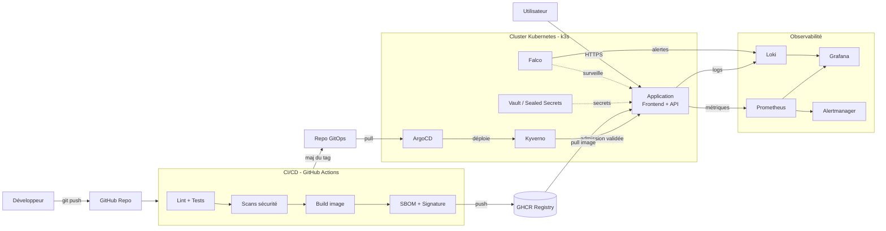

### 13.2 Pipeline CI/CD détaillé (Shift-Left)

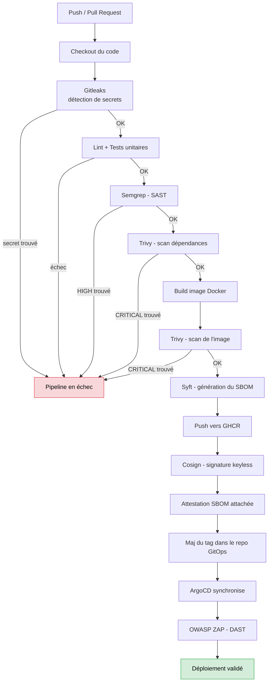

### 13.3 Diagramme de séquence : du commit à la production

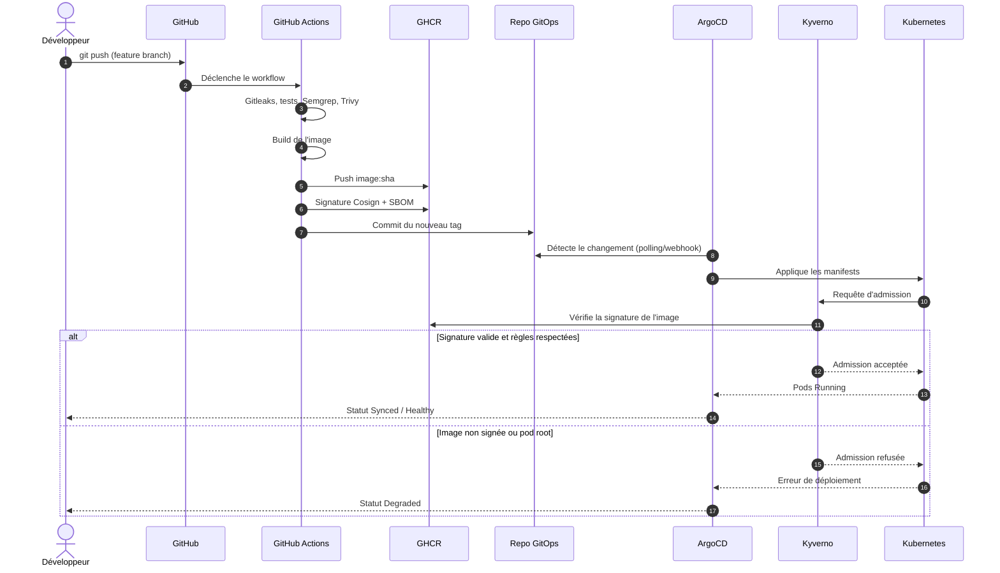

### 13.4 Architecture Kubernetes (namespaces et composants)

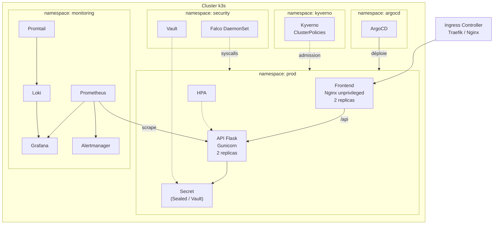

### 13.5 Défense en profondeur (couches de sécurité)

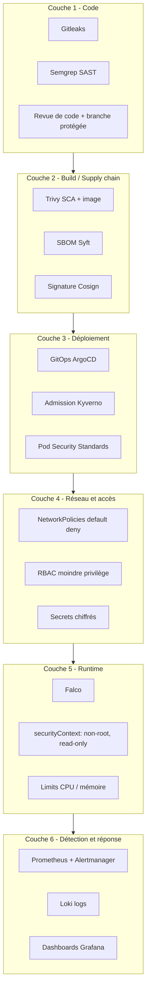

### 13.6 Politique réseau (flux autorisés)

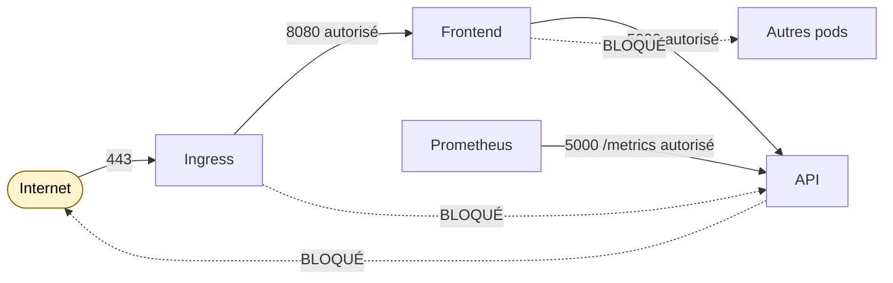

### 13.7 Cycle de vie sécurisé d'une image

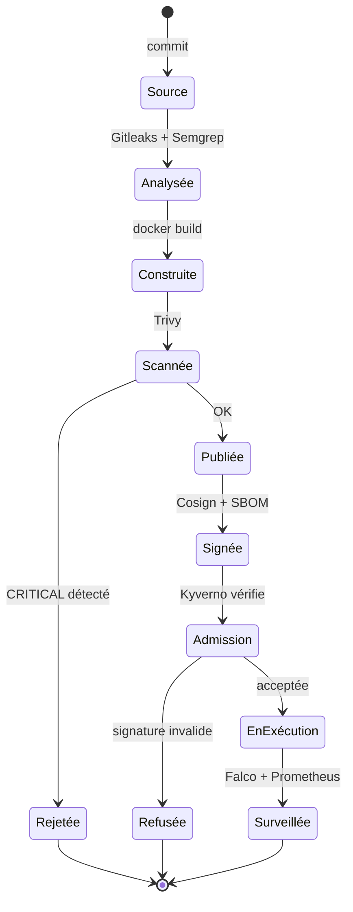

### 13.8 Infrastructure cloud AWS (Terraform)

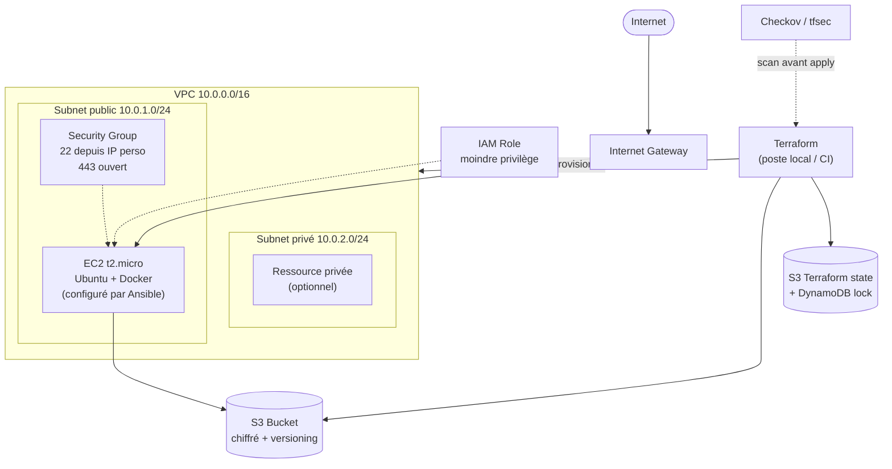

### 13.9 Planning (Gantt)

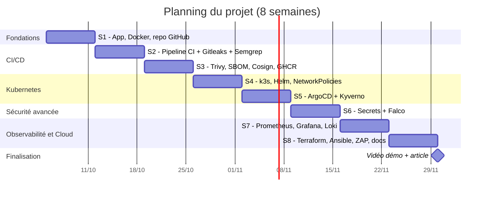

### 13.10 Observabilité

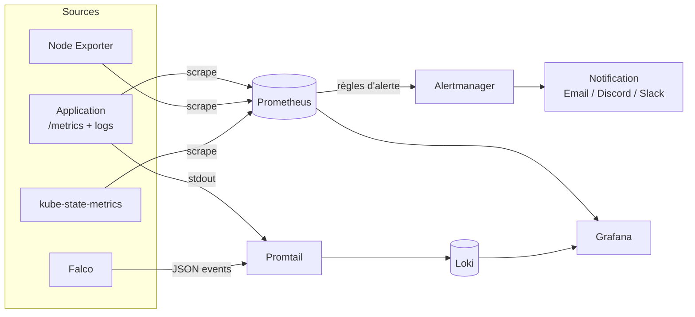

### 13.11 Carte mentale des compétences

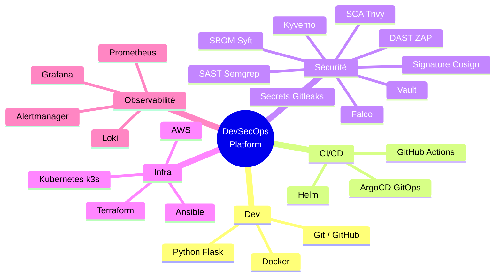

---

## 14. Structure recommandée du dépôt

```
devsecops-platform/
├── .github/
│   └── workflows/
│       ├── ci.yml              # lint, tests, scans, build, signature
│       ├── dast.yml            # OWASP ZAP
│       └── iac-scan.yml        # Checkov / tfsec
├── services/
│   ├── api/                    # Flask + Dockerfile + tests
│   └── frontend/               # Nginx + Dockerfile
├── helm/
│   └── devsecops-app/          # chart Helm
├── gitops/
│   ├── argocd/                 # Applications ArgoCD
│   └── envs/{dev,prod}/        # values par environnement
├── policies/
│   ├── kyverno/                # ClusterPolicies
│   └── network/                # NetworkPolicies
├── infra/
│   ├── terraform/              # AWS (VPC, EC2, S3)
│   └── ansible/                # playbooks
├── observability/
│   ├── dashboards/             # JSON Grafana
│   └── alerts/                 # règles Prometheus
├── docs/
│   ├── architecture.md
│   ├── cahier-des-charges.md
│   ├── vulnerability-report.md
│   └── images/
├── docker-compose.yml
├── Makefile
├── SECURITY.md
├── LICENSE
└── README.md
```

---

## 15. Risques et plan de mitigation

| Risque | Probabilité | Impact | Mitigation |
|---|---|---|---|
| Manque de RAM (16 Go) | Élevée | Moyen | Lancer par phases, k3s, limiter WSL2 à 8 Go, Vault en mode dev |
| Dépassement du free tier AWS | Moyenne | Élevé | Alerte budget à 1 $, `terraform destroy` systématique |
| Complexité de Falco (eBPF sous WSL2) | Moyenne | Moyen | Utiliser le driver `modern_ebpf`, ou tester sur une VM Ubuntu |
| Trop d'outils, apprentissage superficiel | Élevée | Élevé | Un outil à la fois, noter pourquoi chaque choix est fait |
| Retard sur le planning | Moyenne | Moyen | Prioriser les exigences *Must*, reporter les *Could* |
| Fuite d'un secret dans un repo public | Faible | Élevé | Gitleaks en pre-commit et en CI, `.gitignore`, rotation immédiate |

---

## 16. Budget

| Poste | Coût |
|---|---|
| Outils (tous open source) | 0 € |
| GitHub (public) + Actions | 0 € |
| AWS (free tier + destroy) | 0 € |
| Nom de domaine (optionnel) | ≈ 10 € / an |
| **Total** | **0 à 10 €** |

---

## 17. Compétences démontrées (pour le CV)

- Conception d'un pipeline **CI/CD sécurisé** (Shift-Left) avec SAST, SCA, détection de secrets, DAST
- Sécurisation de la **chaîne logistique logicielle** (SBOM, signature Cosign, politique d'admission)
- Déploiement **GitOps** sur Kubernetes (ArgoCD, Helm)
- Durcissement Kubernetes (PSS, NetworkPolicies, RBAC, Kyverno, Falco, CIS)
- **Infrastructure as Code** (Terraform, Ansible) avec scan IaC
- **Observabilité** (Prometheus, Grafana, Loki, alertes)
- Documentation technique, modélisation de menaces (STRIDE), communication

---

## 18. Glossaire

| Terme | Définition |
|---|---|
| **DevSecOps** | Intégration de la sécurité dans toute la chaîne DevOps |
| **Shift-Left** | Déplacer les contrôles de sécurité au plus tôt dans le cycle |
| **SAST / DAST** | Analyse statique du code / dynamique de l'application en cours d'exécution |
| **SCA** | Analyse des dépendances tierces (composition logicielle) |
| **SBOM** | Inventaire des composants d'un logiciel (*Software Bill of Materials*) |
| **GitOps** | Git comme source de vérité unique de l'état du système |
| **Policy as Code** | Règles de conformité exprimées et appliquées automatiquement par le code |
| **Admission Controller** | Composant K8s validant ou refusant une ressource avant sa création |
| **CIS Benchmark** | Guide de durcissement reconnu |
| **IaC** | Infrastructure décrite et gérée par du code |
