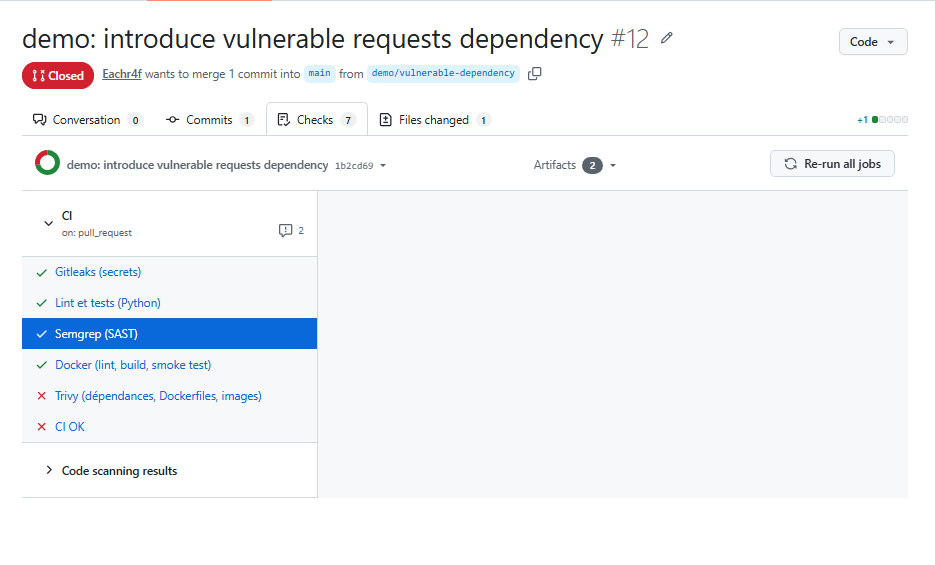
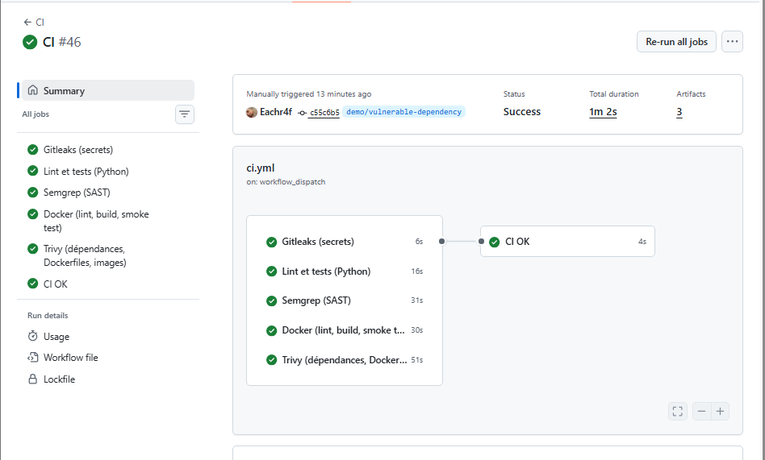

# Rapport de sécurité — Semaines 1 à 3

## Périmètre

Application Flask/SQLite et frontend Nginx exécutés avec Docker Compose.
Les contrôles portent sur le code, les dépendances des images, les
Dockerfiles et le pipeline GitHub Actions.

Les démonstrations utilisent une valeur fictive et un fichier SQL isolé.
Les branches de démonstration ne doivent pas être fusionnées dans main.

## Synthèse des contrôles

| Contrôle | Résultat observé |
|---|---|
| Ruff et formatage | Réussite avec les règles E, F, I, B et S |
| pytest | 16 tests réussis |
| Couverture | 100 % des instructions de app.py ; seuil minimal de 70 % |
| Gitleaks sur HEAD sain | Aucun secret détecté |
| Semgrep sur le code sain | 185 règles exécutées, 23 fichiers analysés, aucune alerte |
| make ci | Code de sortie 0 |
| GitHub Actions | Pipeline sain exécuté avec succès |
| Protection de main | CI OK obligatoire ; fusion bloquée en cas d'échec |

Le scan Semgrep a exclu un fichier supérieur à 1 Mo et un fichier
correspondant aux motifs d'exclusion. L'absence d'alerte concerne le
périmètre effectivement analysé et les règles sélectionnées.

La couverture de tests ne garantit pas l'absence de défauts ou de
vulnérabilités.

## Démonstration 1 — Détection d'un secret fictif

Une valeur fictive a été ajoutée dans services/api/settings.py sur
la branche demo/secret-leak.

Résultats observés :

1. Le hook pre-commit Gitleaks a détecté une fuite et refusé le commit.
2. Le commit de démonstration a été créé avec --no-verify pour tester
   la protection indépendante assurée par la CI.
3. Le job Gitleaks a échoué, ainsi que le contrôle obligatoire CI OK.
4. La fusion de la pull request a été bloquée.
5. Après suppression du fichier dans un nouveau commit, le scan local
   de l'historique a encore détecté la valeur et retourné le code 1.
6. Le scan de l'historique de main n'a détecté aucune fuite.

Conclusion : supprimer un fichier ne retire pas son contenu des
commits précédents. En cas de véritable secret exposé, la première
mesure est sa révocation ou sa rotation.

Preuves à joindre :
- Refus du commit par le hook.
- Gitleaks et CI OK en échec avec fusion bloquée.
- Détection dans l'historique après suppression du fichier.

## Démonstration 2 — Injection SQL

Un fichier isolé services/api/demo_search.py a été ajouté sur la
branche demo/sql-injection. Il construisait une requête SQL par
interpolation directe d'une entrée utilisateur.

Résultats avant correction :

- Ruff a signalé S608.
- Semgrep a produit trois alertes sur la même ligne vulnérable.
- Les jobs Lint et tests, Semgrep et CI OK ont échoué.
- Code scanning a signalé trois nouvelles alertes.
- La fusion a été bloquée.

Les trois alertes correspondent à plusieurs règles détectant la
même construction SQL dangereuse.

Correction : utilisation d'une requête paramétrée avec un marqueur
? et transmission séparée de la valeur.

Résultats après correction :

- Les contrôles de la pull request sont repassés au vert.
- La fusion est redevenue disponible.

La configuration Ruff a ensuite été intégrée séparément dans main
par la PR nº 6, sans intégrer le fichier de démonstration.

Preuves à joindre :
- Contrôles en échec avant correction.
- Détail d'une alerte Code scanning.
- Contrôles réussis après correction.

## Démonstration 3 — Blocage sur échec d'un test

Un test volontairement faux a été ajouté sur test/ci-blocking.

Le job Lint et tests a échoué, puis CI OK a échoué.
Le bouton de fusion était désactivé.

Après suppression du test, les contrôles sont repassés au vert.
Cette démonstration valide le blocage sur échec des tests.

## Images Docker et vulnérabilités connues

Les résultats ci-dessous proviennent des scans locaux antérieurs.
Ils ne constituent pas un nouveau scan des images actuelles.

### Frontend

Le scan initial signalait trois vulnérabilités HIGH.
Après mise à jour des paquets, le rapport de contrôle ne signalait
plus de vulnérabilité HIGH ou CRITICAL.

Rapports :
- [Scan initial](security/trivy-frontend-initial.txt)
- [Scan après mise à jour](security/trivy-frontend-after-update.txt)

### API

Le rafraîchissement de l'image de base n'avait pas supprimé les
44 occurrences HIGH signalées dans les paquets système.
Ces constats restent à suivre.

Le contrôle filtré sur CRITICAL ne signalait aucun résultat.
Cela ne signifie pas que l'image est exempte de vulnérabilités.

Rapports :
- [Scan initial](security/trivy-api-initial.txt)
- [Scan après rafraîchissement](security/trivy-api-after-base-refresh.txt)

Trivy a été utilisé localement ; il n'est pas intégré au workflow
CI de cette étape.

## Fonctionnement et récupération

Après corruption du dépôt Git local, une nouvelle copie a été
récupérée depuis GitHub. git fsck n'a signalé aucune corruption
dans cette copie.

Les tests ont réussi et les deux services sont healthy.
La présence des anciens éléments dans l'application a été
confirmée après le redémarrage de la VM.

## Points de suivi consignés en fin de semaine 2

- Joindre les captures référencées dans ce rapport.
- Vérifier le refus d'un push direct vers main.
- Vérifier la fermeture des PR de démonstration.
- Tag v0.2.0 déjà publié.

## Captures des contrôles CI

### Validation initiale du pipeline

Les contrôles réussissent et le contrôle obligatoire `CI OK` est satisfait.

### Blocage après un échec des tests

L'échec des tests entraîne l'échec de `CI OK` et bloque la fusion.

### Blocage après détection d'un secret fictif

Gitleaks détecte le secret fictif utilisé pour la démonstration.
Le contrôle `CI OK` échoue et la fusion est bloquée.

### Blocage après introduction d'une injection SQL

Ruff et Semgrep signalent la construction SQL vulnérable.
Le contrôle `CI OK` échoue et la fusion est bloquée.

## Semaine 3 — État initial des scans Trivy du 14 octobre 2026

Outil utilisé : Trivy 0.74.0.

### Résultats observés

| Périmètre | Sans filtrage des vulnérabilités sans correctif | Avec --ignore-unfixed |
|---|---|---|
| Dépendances déclarées et Dockerfiles | Aucun résultat HIGH/CRITICAL détecté | Aucun résultat HIGH/CRITICAL détecté |
| Image API : paquets Debian | 44 occurrences HIGH, 0 CRITICAL | Aucun résultat HIGH/CRITICAL détecté |
| Image API : dépendances Python reconnues | Aucun résultat HIGH/CRITICAL détecté | Aucun résultat HIGH/CRITICAL détecté |
| Image frontend : paquets Alpine | Aucun résultat HIGH/CRITICAL détecté | Aucun résultat HIGH/CRITICAL détecté |

Les 44 occurrences de l'image API correspondent à 8 identifiants CVE
distincts, certains concernant plusieurs paquets.

Dans le rapport initial, aucune version corrigée n'est indiquée pour
ces occurrences. Elles restent présentes : --ignore-unfixed les exclut
du contrôle bloquant, sans les corriger.

### Politique de contrôle

La cible make scan analyse les dépendances et les Dockerfiles, construit
les deux images, puis analyse leurs composants.

Les vulnérabilités HIGH/CRITICAL disposant d'un correctif connu de Trivy
font échouer le contrôle grâce à --exit-code 1.
Les mauvaises configurations HIGH/CRITICAL détectées bloquent également.

Le contrôle local make scan a terminé avec le code 0.

### Suivi des vulnérabilités sans correctif

Responsable du suivi : Achraf Ettanouti.
Prochaine revue prévue : 21 octobre 2026, ou avant une publication d'image.

À chaque revue :
- relancer le scan sans --ignore-unfixed ;
- vérifier les correctifs disponibles ;
- mettre à jour les composants concernés et reconstruire les images ;
- conserver les nouveaux résultats.

L'exploitabilité des CVE dans cette application n'a pas encore été
établie. L'exécution non-root et les restrictions Docker ne suffisent
pas à les déclarer inexploitables.

### Preuves

Rapports conservés dans docs/security/week3/ :
- fs-avant.txt ;
- api-avant.txt ;
- frontend-avant.txt ;
- api-corrigeables.txt ;
- frontend-corrigeables.txt.

Les rapports d'images initiaux portent sur les tags locaux :week3.
La cible make scan construit et contrôle les tags locaux :ci.

## Semaine 3 — Publication et vérifications du 23 octobre 2026

Le job Trivy est intégré à la CI et au contrôle obligatoire CI OK.
Le workflow Publish analyse également chaque image avant publication.

Les images API et frontend du commit
`9c511d3e84fa307213246ead04dc54594ff8e21d` ont été publiées sur GHCR,
accompagnées de SBOM SPDX 2.3, signées et vérifiées.

### Vérifications indépendantes depuis la VM

- Signatures API et frontend : vérifiées avec l'identité exacte du workflow.
- Attestations SBOM API et frontend : vérifiées.
- Mauvaise identité demandée : refus pour les deux images, code 1.
- Ancienne image API accessible mais non signée : refus
  `no signatures found`, code 10.
- Inventaires extraits : 111 entrées pour l'API, 72 pour le frontend.

Les nombres d'entrées du SBOM ne représentent pas des vulnérabilités.

Digests, commandes et limites :
[documentation de la chaîne logicielle](supply-chain.md).

Preuves :
[dossier de vérification](security/week3/verification/).

### Suivi encore ouvert

La revue des vulnérabilités sans correctif était prévue le 21 octobre 2026.
Sa réalisation n'est pas documentée ici. Un nouveau scan sans
`--ignore-unfixed` des images publiées reste à conserver et à analyser.

Les résultats du 14 octobre décrivent les anciennes images locales :
ils ne doivent pas être présentés comme les résultats complets des images
publiées le 23 octobre.

Le suivi de la démonstration Trivy a été finalisé le 25 octobre 2026 :
PR #12 rouge avant correction, puis CI #46 verte après suppression de
la dépendance inutilisée. La PR #12 est restée fermée sans fusion.

## Revue des images publiées — 25 octobre 2026

La revue prévue le 21 octobre a été effectuée le 25 octobre.
Trivy 0.74.0 a actualisé sa base de vulnérabilités avant l'analyse.

Périmètre : images publiées et vérifiées le 23 octobre, référencées
par les digests enregistrés dans les fichiers de preuve.
Ces résultats ne couvrent pas les publications ultérieures.

Analyse : HIGH/CRITICAL, sans exclusion des vulnérabilités sans correctif.

| Périmètre | Résultat |
|---|---|
| API : paquets Debian | 44 occurrences HIGH, 8 CVE distinctes, 0 CRITICAL |
| API : dépendances Python reconnues | Aucun résultat HIGH/CRITICAL |
| Frontend : paquets Alpine | Aucun résultat HIGH/CRITICAL |

Aucune version corrigée n'est renseignée pour les constats de l'API.
Ils restent ouverts et suivis. Leur exploitabilité dans cette application
n'a pas été établie.

La politique bloquante reste inchangée : vulnérabilités HIGH/CRITICAL
avec correctif. Aucun résultat de ce rapport ne justifie une nouvelle
exception ciblée.

L'avertissement Trivy sur la liste EOL d'Alpine 3.24 ne constitue pas
une confirmation de fin de support.

Responsable : Achraf Ettanouti.
Prochaine revue prévue : 1er novembre 2026, ou avant le prochain
déploiement si celui-ci intervient plus tôt.

Preuves : [rapports du 25 octobre](security/week3/revue-20261025/).

## Revue des images publiées — 25 octobre 2026

La revue prévue le 21 octobre a été effectuée le 25 octobre.
Trivy 0.74.0 a actualisé sa base de vulnérabilités avant l'analyse.

Périmètre : images publiées et vérifiées le 23 octobre, référencées
par les digests enregistrés dans les fichiers de preuve.
Ces résultats ne couvrent pas les publications ultérieures.

Analyse : HIGH/CRITICAL, sans exclusion des vulnérabilités sans correctif.

| Périmètre | Résultat |
|---|---|
| API : paquets Debian | 44 occurrences HIGH, 8 CVE distinctes, 0 CRITICAL |
| API : dépendances Python reconnues | Aucun résultat HIGH/CRITICAL |
| Frontend : paquets Alpine | Aucun résultat HIGH/CRITICAL |

Aucune version corrigée n'est renseignée pour les constats de l'API.
Ils restent ouverts et suivis. Leur exploitabilité dans cette application
n'a pas été établie.

La politique bloquante reste inchangée : vulnérabilités HIGH/CRITICAL
avec correctif. Aucun résultat de ce rapport ne justifie une nouvelle
exception ciblée.

L'avertissement Trivy sur la liste EOL d'Alpine 3.24 ne constitue pas
une confirmation de fin de support.

Responsable : Achraf Ettanouti.
Prochaine revue prévue : 1er novembre 2026, ou avant le prochain
déploiement si celui-ci intervient plus tôt.

Preuves : [rapports du 25 octobre](security/week3/revue-20261025/).

## Démonstration Trivy — Correction vérifiée le 25 octobre 2026

- Avant : ajout de `requests==2.19.1` dans la PR #12,
  commit `1b2cd69`. Trivy et CI OK ont échoué.
- Correction : suppression de cette dépendance inutilisée,
  commit `c55c6b5`, sur `demo/vulnerable-dependency`.
- Après : exécution manuelle CI #46 sur cette branche.
  Les six jobs, dont Trivy et CI OK, ont réussi.
- La PR #12 est restée fermée sans fusion.

La preuve après correction provient d'une exécution workflow_dispatch,
et non d'une nouvelle exécution de la PR fermée.

### Preuves de la démonstration Trivy

- [PR #12 : démonstration fermée sans fusion](https://github.com/Eachr4f/devsecops-platform/pull/12)
- [CI #46 : réussite après correction](https://github.com/Eachr4f/devsecops-platform/actions/runs/40214305902)

Avant correction : Trivy et CI OK échouent.

Après correction : les six jobs réussissent lors de l'exécution manuelle
sur la branche corrigée.

